# ⛺ CampIn — Peer-to-Peer Camping Gear Rental Marketplace

## Deskripsi
**CampIn** adalah aplikasi *Peer-to-Peer* (P2P) *Marketplace* penyewaan peralatan pendakian dan berkemah berbasis **Kotlin 2.0 (JVM)** yang menerapkan prinsip *Object-Oriented Programming* (OOP) secara menyeluruh. Sistem ini mempertemukan tiga peran pengguna (**Penyewa**, **Mitra Penyedia**, dan **Admin Platform**) dalam satu ekosistem penyewaan lengkap dengan verifikasi mitra, perhitungan deposit polimorfik, rekomendasi cuaca puncak gunung secara *real-time*, simulasi pembayaran QRIS Midtrans, serta mekanisme *escrow* bagi hasil dan pengembalian deposit (*refund*).

## Anggota Kelompok
| Nama Lengkap | NIM | Peran |
| :--- | :--- | :--- |
| Muhamad Huwaiza Rafi | 225443044 | Project Lead / System Architect |
| Viseila Azrivania Sumarna | 225443052 | Domain Developer |
| Moch Raflisya’id Marzuki N | 225443041 | Business Logic Developer |
| Naa’ila Zahra Assyifaa | 225443047 | UI / Mobile-Web & CLI Developer |
| Edra Christian D | 225443031 | QA + Data & API Developer |
| Dhiya Nasywa Nafi’ah Salsabila Marjaya | 225443030 | DevOps Engineer |

## UML Class Diagram Sistem CampIn

```mermaid
classDiagram
    class AlatCamping {
        <<abstract>>
        +id: String
        +nama: String
        +hargaSewaPerHari: Int
        +idPenyedia: String
        +tersedia: Boolean
        +kategori()* String
        +deskripsi()* String
        +hitungDeposit()* Int
        +tandaiDisewa()
        +tandaiDikembalikan()
    }

    class Tenda {
        +kapasitasOrang: Int
        +tipeLayer: String
        +kategori() String
        +deskripsi() String
        +hitungDeposit() Int
    }

    class TasCarrier {
        +kapasitasLiter: Int
        +adaRaincover: Boolean
        +kategori() String
        +deskripsi() String
        +hitungDeposit() Int
    }

    class PerlengkapanTidur {
        +suhuMinimalDerajat: Int
        +bahanIsian: String
        +kategori() String
        +deskripsi() String
        +hitungDeposit() Int
    }

    AlatCamping <|-- Tenda
    AlatCamping <|-- TasCarrier
    AlatCamping <|-- PerlengkapanTidur

    class Pengguna {
        <<sealed>>
        +id: String
        +nama: String
        +email: String
        +passwordHash: String
        +peran()* String
        +infoSingkat()* String
    }

    class Penyewa {
        +noTelepon: String
        +saldoRefundDeposit: Int
        +terimaRefundDeposit(nominal: Int)
        +peran() String
        +infoSingkat() String
    }

    class Penyedia {
        +namaToko: String
        +terverifikasi: Boolean
        +saldoDompet: Int
        +verifikasiAkun()
        +tambahSaldo(nominal: Int)
        +peran() String
        +infoSingkat() String
    }

    class AdminPlatform {
        +levelAkses: String
        +peran() String
        +infoSingkat() String
    }

    Pengguna <|-- Penyewa
    Pengguna <|-- Penyedia
    Pengguna <|-- AdminPlatform

    class StatusSewa {
        <<enumeration>>
        MENUNGGU_PEMBAYARAN
        AKTIF_DISEWA
        SELESAI_DIKEMBALIKAN
    }

    class TransaksiSewa {
        <<data>>
        +id: String
        +alatId: String
        +penyewaId: String
        +durasiHari: Int
        +totalBiayaSewa: Int
        +totalDeposit: Int
        +kodePembayaran: String
        +tanggalPinjam: LocalDate
        +tanggalKembali: LocalDate?
        +dendaTerlambat: Int
        +depositDikembalikan: Int
        +status: StatusSewa
        +tanggalJatuhTempo: LocalDate
        +sedangDisewa: Boolean
        +grandTotalBayar: Int
    }

    TransaksiSewa --> StatusSewa

    class PencarianAlat {
        <<interface>>
        +cariAlat(keyword: String) List~AlatCamping~
    }

    class CampInRepository {
        <<interface>>
        +initSchema()
        +simpanPengguna(pengguna: Pengguna)
        +updatePenyedia(id: String, terverifikasi: Boolean, saldo: Int)
        +updateSaldoRefundPenyewa(id: String, saldoRefund: Int)
        +ambilSemuaPengguna() List~Pengguna~
        +simpanAlat(alat: AlatCamping)
        +updateStatusAlat(id: String, tersedia: Boolean)
        +ambilSemuaAlat() List~AlatCamping~
        +simpanTransaksi(trx: TransaksiSewa)
        +updatePengembalianTransaksi(id: String, tanggalKembali: String, denda: Int, depositDikembalikan: Int, status: String)
        +ambilSemuaTransaksi() List~TransaksiSewa~
    }

    class PaymentGateway {
        <<interface>>
        +buatTagihanQris(orderId: String, nominal: Int) String
    }

    class PasswordHasher {
        <<object>>
        +hash(rawPassword: String) String
        +verify(rawPassword: String, hashed: String) Boolean
    }

    class CampInService {
        -alatMap: ConcurrentHashMap~String, AlatCamping~
        -penggunaMap: ConcurrentHashMap~String, Pengguna~
        -transaksiList: CopyOnWriteArrayList~TransaksiSewa~
        +totalKomisiPlatform: Int
        +registrasiPengguna(pengguna: Pengguna, rawPassword: String)
        +login(idAtauEmail: String, rawPassword: String) Pengguna
        +verifikasiPenyedia(adminId: String, penyediaId: String)
        +tambahAlat(alat: AlatCamping)
        +sewaAlat(alatId: String, penyewaId: String, durasiHari: Int) TransaksiSewa
        +kembalikanAlat(transaksiId: String, hariTerlambat: Int) TransaksiSewa
        +cariAlat(keyword: String) List~AlatCamping~
        +simpanKeCsv(path: String)
    }

    PencarianAlat <|.. CampInService
    CampInRepository <|.. MySqlCampInRepository
    PaymentGateway <|.. MidtransPaymentApi
    CampInService "1" *-- "0..*" AlatCamping
    CampInService "1" *-- "0..*" Pengguna
    CampInService "1" *-- "0..*" TransaksiSewa
    CampInService --> CampInRepository
    CampInService --> PaymentGateway
    CampInService --> PasswordHasher

```


## Fitur Utama
- [x] **Autentikasi Multi-Role & Manajemen Sesi**: Hashing password menggunakan **SHA-256** (`PasswordHasher`) dan pemisahan halaman berbasis *HTTP Cookie Session* (`/katalog`, `/sewa-saya`, `/mitra`, `/admin`) disertai tombol *1-Click Demo Login*.
- [x] **Verifikasi KYC Mitra oleh Admin**: Mitra baru wajib diverifikasi oleh Admin Platform sebelum dapat menambahkan katalog peralatan.
- [x] **Katalog Polimorfik & Perhitungan Deposit Otomatis**: Mendukung subclass `Tenda`, `TasCarrier`, dan `PerlengkapanTidur` dengan rumus deposit dan deskripsi spesifik tiap jenis alat.
- [x] **Telemetri Cuaca Gunung Real-Time**: Integrasi Ktor Client ke **Open-Meteo REST API** untuk menampilkan suhu, kecepatan angin, dan rekomendasi gear pendakian.
- [x] **Checkout QRIS & Sistem *Escrow* Otomatis**: Pembuatan tagihan QRIS Midtrans dengan visualisasi SVG QR Code, perhitungan jatuh tempo otomatis, potongan denda keterlambatan dari deposit, pengembalian sisa deposit ke Penyewa, pencairan 90% biaya sewa ke Mitra, dan pencatatan 10% komisi platform.
- [x] **Dual Interface & Dual Persistence**: Mendukung antarmuka **Mobile-First Web UI** dan **CLI Interaktif**, terhubung ke **MySQL 8.0** dengan *auto-fallback* ke **SQLite** lokal dan ekspor cadangan CSV.

## Cara Menjalankan

### 1. Menjalankan Unit Test Otomatis (10 Skenario JUnit 5)
```bash
./gradlew test
```

### 2. Menjalankan Secara Lokal (CLI + Web UI)
```bash
./gradlew run --console=plain
Buka peramban (browser) dan akses http://localhost:8080 (password bawaan seluruh akun demo: 123456).
```

### 3. Menjalankan dengan Docker Compose (Aplikasi + MySQL 8.0)
```bash
docker compose build
docker compose run --rm --service-ports campin
```

## Teknologi & Pustaka Open-Source
- Kotlin 2.0.21 (JVM 17) & Gradle Kotlin DSL
- Ktor Client & Server Netty 2.3.12 + Kotlinx Serialization JSON
- MySQL Connector/J 8.4.0 & SQLite JDBC 3.46.0.0
- Tailwind CSS (CDN) untuk antarmuka responsif mobile-first
- JUnit 5 (kotlin-test), Docker Multi-Stage, dan GitHub Actions CI

## Catatan Arsitektur & Pengembangan Lanjutan (Known Limitations)
1.  Simulasi Pembayaran QRIS & Webhook: Saat berjalan tanpa MIDTRANS_SERVER_KEY produksi, sistem menghasilkan tautan transaksi Sandbox terstruktur beserta visualisasi SVG QR Code agar pengujian lokal maupun di dalam container Docker berjalan mandiri.
2. Manajemen Sesi Web: Menggunakan HTTP Cookie Session ringan (CAMPIN_USER_ID) untuk memisahkan hak akses antar-peran beserta 1-Click Demo Switcher untuk mempercepat evaluasi demonstrasi.
3. Skema Penyewaan Per Unit Fisik: Status ketersediaan alat dikelola secara real-time (tersedia: Boolean) dengan mekanisme thread-safe (@Synchronized dan ConcurrentHashMap) untuk mencegah double booking.

# Lisensi
MIT License
